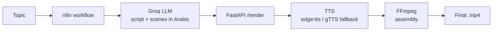
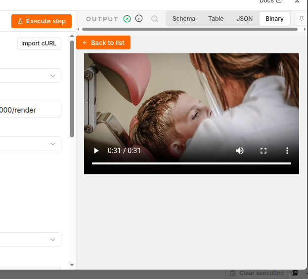

# AI Educational Video Pipeline

**Topic → educational video in Arabic, automatically.**

Give the pipeline a single topic (for example, *Moroccan couscous*). An n8n workflow uses an LLM to write the script and scenes, then a FastAPI service generates the voice-over and renders the final video with FFmpeg. Everything runs on free tools.

## Architecture



1. **n8n** receives the topic and orchestrates the whole flow.
2. **Groq (LLM)** generates a structured script split into scenes (Arabic text per scene).
3. **FastAPI** receives the scenes and, for each one, generates the voice-over.
4. **TTS** converts Arabic text to speech (see [Voice](#voice)).
5. **FFmpeg** assembles audio and visuals into the final video.


## Prerequisites

- Python 3.12
- [FFmpeg](https://ffmpeg.org/) (`sudo apt install ffmpeg` on Ubuntu/WSL)
- [n8n](https://n8n.io/) (self-hosted or cloud)
- A free [Groq](https://console.groq.com/) API key

## Installation

```bash
git clone https://github.com/kawtarsouhail/ai-video-demo.git
cd ai-video-demo
python3.12 -m venv .venv
source .venv/bin/activate
pip install -r requirements.txt
cp .env.example .env      # then fill in your keys
```

## Run

Start the API:

```bash
uvicorn main:app --reload
```

Then import the workflow into n8n (`n8n/workflow.json`), set your Groq credentials in n8n, point the HTTP node to your FastAPI URL (default `http://localhost:8000`), and run it with a topic.

## Environment variables

Copy `.env.example` to `.env` and fill in the values:

| Variable | Description |
|---|---|
| `GROQ_API_KEY` | API key for the LLM (used in n8n) |

Never commit your `.env` file.

## Voice

- **Primary:** [edge-tts](https://github.com/rany2/edge-tts) with an Arabic neural voice.
- **Automatic fallback:** [gTTS](https://github.com/pndurette/gTTS). edge-tts relies on an unofficial Microsoft service that can reject requests (HTTP 403), so the API switches to gTTS when it fails. The fallback voice is simpler and has no speed or pitch control.

## Demo

<!-- Add a screenshot of the final video and/or a link to a short demo -->



## Tech stack

n8n · Groq (LLM) · FastAPI · edge-tts · gTTS · FFmpeg · Python

## Author

**Kawtar Souhail** · [Portfolio](https://kawtar-portfolio-ten.vercel.app/) · [LinkedIn](https://www.linkedin.com/in/kawtar-souhail-44a969250) · [GitHub](https://github.com/kawtarsouhail)
